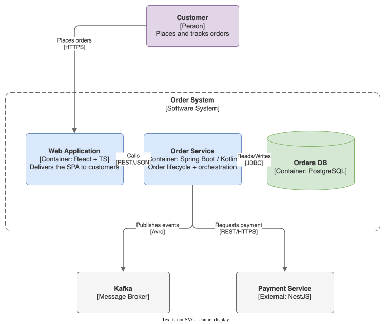

# draw-io

A Claude Code / Cursor plugin that generates **editable draw.io diagrams** and exports them as **house-themed SVG** — the diagram XML stays embedded, so the `.svg` renders anywhere *and* reopens in draw.io for editing. A flat, `adaptiveColors` theme keeps every diagram readable in both light and dark preview.

## Gallery



*C4 container diagram, house theme applied end-to-end — [walkthrough](./skills/drawio/examples/c4-order-service.md).*

## What it does

- **Author as Mermaid or XML** → native `.drawio`. Mermaid gets auto-laid-out by draw.io; XML gives precise control and works with no CLI.
- **Export as SVG/PNG/PDF** with embedded, editable XML (SVG is the default deliverable).
- **ELK auto-layout** for XML-authored graphs (`verticalFlow`, `organic`, …).
- **Browser-URL output** — open a diagram directly in `app.diagrams.net`, no install needed to view.

## Prerequisite

**draw.io Desktop** must be installed (`drawio` on PATH) for SVG/PNG/PDF export and Mermaid conversion — it is a GUI host app and cannot be bundled. Without it the skill degrades to XML/URL delivery. See the [SKILL](./skills/drawio/SKILL.md#prerequisite--drawio-desktop) for platform paths.

## Install

### Claude Code

Add this repository as a plugin marketplace, then install:

```
/plugin marketplace add https://codeberg.org/torgge/skills
/plugin install draw-io@torgge-skills
```

### Cursor

Install from the [Cursor Marketplace](https://cursor.com/marketplace) once listed, or point Cursor at this plugin directory (`.cursor-plugin/plugin.json`).

## License

MIT © George Bonespirito. Built on the [draw.io Desktop](https://www.drawio.com/) CLI (draw.io / diagrams.net by JGraph Ltd), a separate project under its own license.
