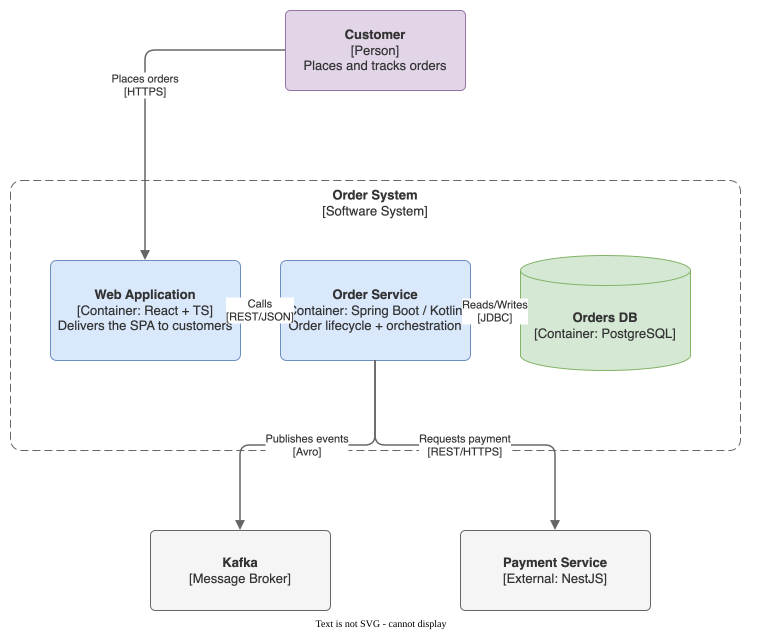

# Order System — C4 Container

Diagrama C4 (nível 2, container) do fluxo de pedidos, gerado pela skill `drawio`
como SVG editável (XML `.drawio` embarcado — reabra o `.svg` no draw.io para editar).

## Elementos

| Elemento | Tipo | Tech |
|---|---|---|
| Customer | Person | — |
| Web Application | Container | React + TS |
| Order Service | Container | Spring Boot / Kotlin |
| Orders DB | Container | PostgreSQL |
| Kafka | Message Broker | — |
| Payment Service | External System | NestJS |

House-theme aplicado: `adaptiveColors="auto"` (legível em preview claro e escuro),
paleta flat, cantos suaves, edges ortogonais.
