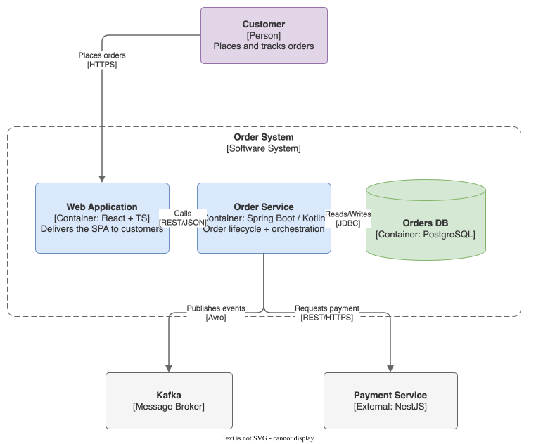

# Order System — C4 Container

A C4 level-2 (container) diagram of the order flow, generated by the `drawio`
skill as an editable SVG (the `.drawio` XML is embedded — reopen the `.svg` in
draw.io to edit it).

## Elements

| Element | Type | Tech |
|---|---|---|
| Customer | Person | — |
| Web Application | Container | React + TS |
| Order Service | Container | Spring Boot / Kotlin |
| Orders DB | Container | PostgreSQL |
| Kafka | Message Broker | — |
| Payment Service | External System | NestJS |

House theme applied: `adaptiveColors="auto"` (readable in both light and dark
preview), flat palette, soft corners, orthogonal edges.
